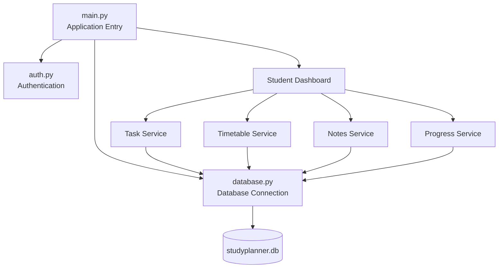
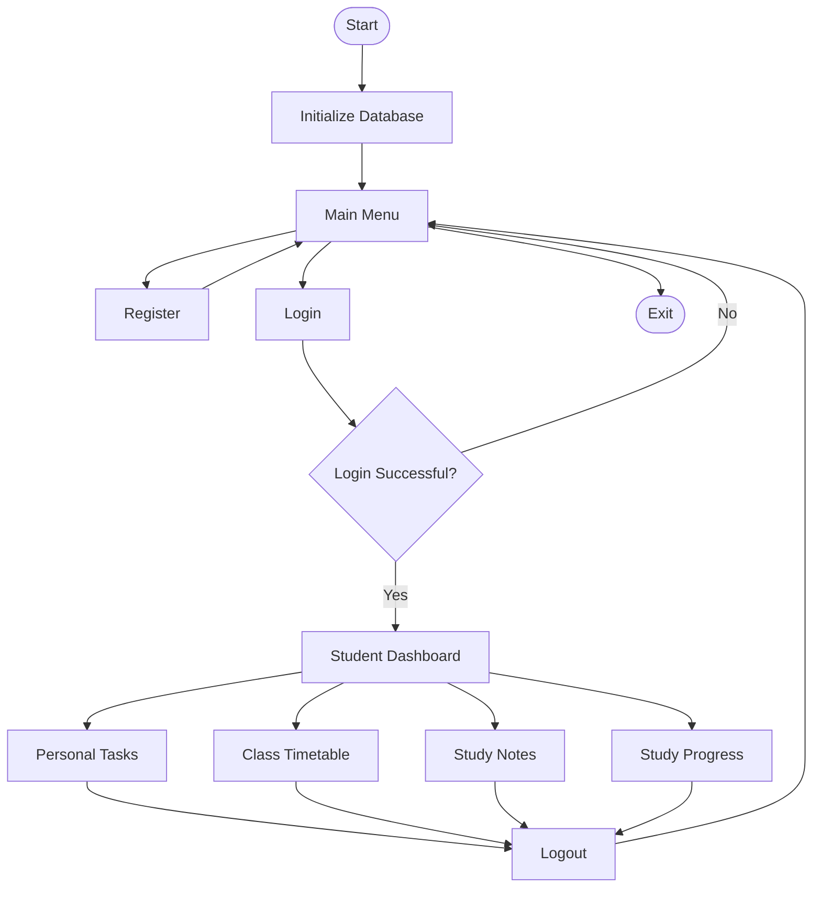
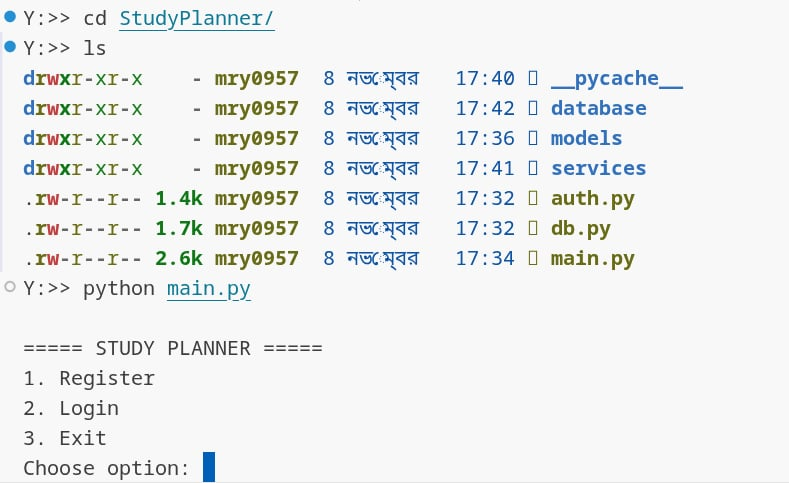
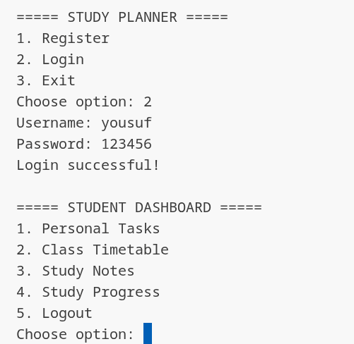
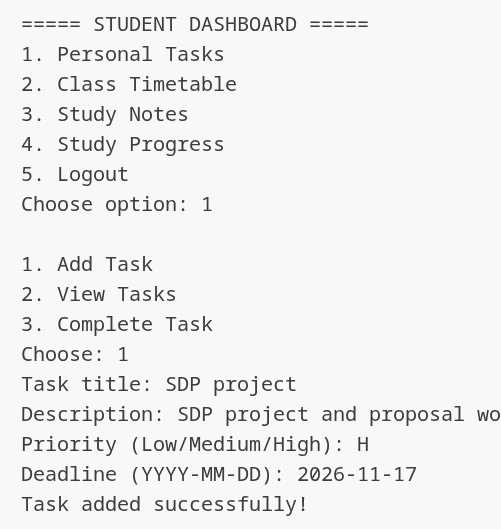
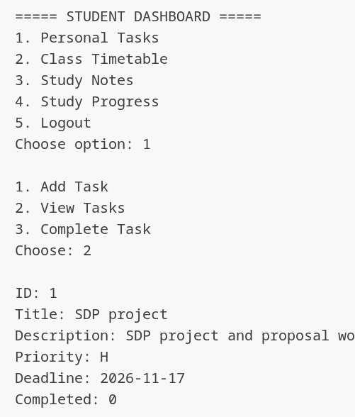
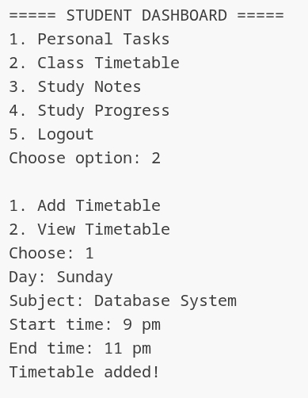
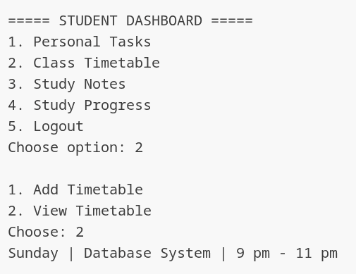
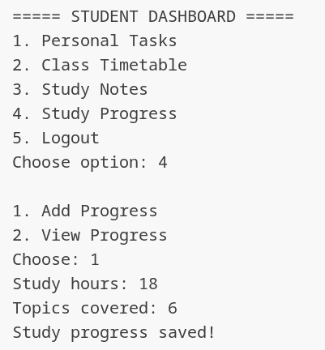
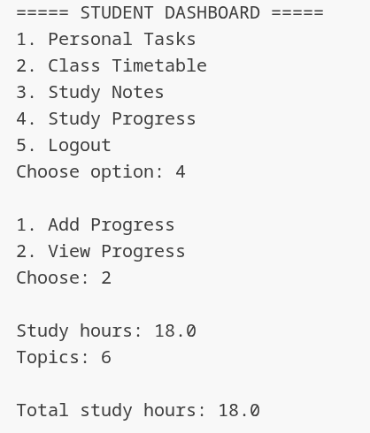

 <div align="center">
  
# 📚 StudyPlanner

### 🎓 Academic Productivity & Study Management Module

<p>
  
  
  
  
</p>

<p>
  
  
</p>

**Organize Your Studies • Manage Your Tasks • Track Your Progress**

A Python-based academic management module developed as a part of the larger **Student-Assistance** project.

<br>

[📂 Main Repository](https://github.com/rimontanber96/Student-Assistance) · [🐍 Python](https://www.python.org/) · [🗄️ SQLite](https://www.sqlite.org/)

</div>

---

## 📖 About This Module

**StudyPlanner** is a dedicated academic productivity module within the [Student-Assistance](https://github.com/rimontanber96/Student-Assistance) project.

It focuses on helping students organize their academic responsibilities through a simple, structured, and modular Python application.

The module brings together essential study management functionalities:

- Personal task management
- Class timetable organization
- Study notes management
- Study progress tracking
- User registration and authentication

Unlike a Django-based web application, StudyPlanner is implemented using **Pure Python and SQLite** to demonstrate fundamental programming, database management, and software architecture concepts.

> 💡 **Project Relationship:** StudyPlanner is one component of Student-Assistance. It is designed as a separate module that can contribute to the functionality of the overall project.

---

## 🎯 Objectives

- Simplify academic task organization.
- Maintain a structured class timetable.
- Keep study notes organized.
- Monitor personal study progress.
- Implement basic user authentication.
- Practice Python modular programming.
- Understand relational database operations.
- Build a foundation for future module integration.

---

## 🌟 Core Modules & Features

| Module | Description |
|:---|:---|
| 🔐 Authentication | User registration and login |
| 📌 Personal Tasks | Organize academic tasks |
| 📅 Timetable | Manage class schedules |
| 📝 Study Notes | Store and access study notes |
| 📊 Progress | Record study progress |
| 🗄️ Database | Persistent SQLite storage |

### 🔐 01. Authentication System

- User registration.
- Login verification.
- Password hashing.
- User-specific record management.

### 📌 02. Personal Task Management

- Add personal tasks.
- Organize task priorities.
- Set task deadlines.
- View saved tasks.
- Track task completion.

### 📅 03. Class Timetable

- Add class schedules.
- Store subject information.
- Organize classes by day and time.
- View saved timetable records.

### 📝 04. Study Notes

- Create study notes.
- Store note titles and content.
- View saved notes.

### 📊 05. Study Progress

- Record study hours.
- Store completed topics.
- View study records.
- Monitor accumulated study time.

---

## ⚡ Technology Stack

<p align="left">
  
</p>

| Technology | Application |
|:---|:---|
| Python 3.x | Core programming language |
| SQLite | Local relational database |
| SQL | Database queries |
| hashlib | Password hashing |
| os | Operating system and file utilities |
| Git | Version control |
| GitHub | Repository hosting |
| VS Codium | Development environment |

### 💡 Why Pure Python Instead of Django?

This module intentionally uses Pure Python rather than Django.

The purpose is to understand how an application works at a fundamental level without depending on a full-stack web framework.

**Concepts practiced:**

- Functions and classes
- Modular programming
- Python packages
- Database connections
- SQL CRUD operations
- Authentication logic
- Data persistence
- Application navigation

**Why SQLite?**

SQLite is lightweight, serverless, and included in Python's standard library through `sqlite3`. It is suitable for a small local application.

---

## 🏗️ System Architecture

StudyPlanner follows a modular architecture that separates application control, authentication, data models, business logic, and database operations.



### Architecture Responsibilities

| Layer | Responsibility |
|:---|:---|
| Application | Controls the main program |
| Authentication | Handles user access |
| Models | Represents application data |
| Services | Contains feature-specific operations |
| Database | Stores and retrieves records |

---

## 📂 Project Structure

```text
StudyPlanner/
│
├── main.py
├── database.py
├── auth.py
│
├── models/
│   ├── __init__.py
│   ├── task.py
│   ├── timetable.py
│   ├── notes.py
│   └── progress.py
│
├── services/
│   ├── __init__.py
│   ├── task_service.py
│   ├── timetable_service.py
│   ├── notes_service.py
│   └── progress_service.py
│
└── database/
    └── studyplanner.db
```

### 📁 Directory Explanation

| File / Directory | Purpose |
|:---|:---|
| `main.py` | Main application entry point |
| `database.py` | Database initialization and connection management |
| `auth.py` | Registration and login functionality |
| `models/` | Data model definitions |
| `services/` | Application business logic |
| `database/` | SQLite database storage |
| `__init__.py` | Defines regular Python packages |

---

## 🔄 Application Workflow



---

## 🖥️ Application Preview

Screenshots of the actual command-line application will be displayed here.

### 01. Main Menu



### 02. Student Dashboard



### 03. Personal Task Management




### 04. Class Timetable




### 05. Study Progress




> 📌 Add your actual application screenshots to `studyplannerImage/` using the filenames above. Until then, these preview images will not render.

---

## 🚀 Getting Started

### Prerequisites

Make sure you have:

- Python 3.x
- VS Code or VS Codium
- Git (optional)

No third-party Python packages are required for the basic implementation if it uses only the standard-library modules.

### 01. Clone the Main Repository

```bash
git clone https://github.com/rimontanber96/Student-Assistance.git
```

### 02. Navigate to StudyPlanner

```bash
cd Student-Assistance/StudyPlanner
```

### 03. Run the Application

```bash
python main.py
```

### 04. Register or Login

The application starts with the following menu:

```text
===== STUDY PLANNER =====

1. Register
2. Login
3. Exit

Choose option:
```

Select `1` to register or `2` to log in.

### 05. Access the Dashboard

```text
===== STUDENT DASHBOARD =====

1. Personal Tasks
2. Class Timetable
3. Study Notes
4. Study Progress
5. Logout

Choose option:
```

Choose a module to start managing your academic activities.

---

## 🗄️ Database Design

StudyPlanner uses SQLite to maintain persistent application data.

### Database Components

| Table | Description |
|:---|:---|
| `users` | User account information |
| `tasks` | Personal study tasks |
| `timetable` | Class schedule records |
| `notes` | Study notes |
| `progress` | Study progress records |

The academic records are associated with users through `user_id`, where implemented in the database schema.

---

## 🛡️ Design Decisions

| Decision | Reason |
|:---|:---|
| Pure Python | Practice core Python concepts |
| SQLite | Lightweight local database |
| Modular structure | Easier maintenance and extension |
| Separate Models | Organize application data |
| Separate Services | Keep feature logic organized |
| `__init__.py` | Explicit regular package structure |

### Why Not Django?

Django provides many built-in features, including routing, ORM, authentication, and an admin interface.

However, using Django would hide some of the lower-level implementation details that this educational module is intended to demonstrate.

StudyPlanner therefore uses a simpler approach to understand how these components work internally.

---

## 🚧 Development Status

| Feature | Status |
|:---|:---|
| Registration | Implemented |
| Login | Implemented |
| Task Management | Initial implementation |
| Timetable Management | Initial implementation |
| Study Notes | Initial implementation |
| Progress Tracking | Initial implementation |
| SQLite Integration | Implemented |
| Graphical Interface | Future scope |
| Advanced Analytics | Future scope |

---

## 🚀 Future Improvements

- [ ] Complete CRUD operations.
- [ ] Improve input validation.
- [ ] Add weekly and monthly analytics.
- [ ] Introduce study reminders.
- [ ] Add a graphical user interface.
- [ ] Improve database relationships.
- [ ] Implement automated testing.
- [ ] Integrate with other Student-Assistance modules.

---

## 🔗 Main Project

StudyPlanner is part of the larger Student-Assistance project.

Explore the complete repository to understand the other modules and the overall project architecture.

<div align="center">

### 🎓 Student-Assistance

[](https://github.com/rimontanber96/Student-Assistance)

</div>

---

## 🤝 Contribution

Contributions to the larger Student-Assistance project are welcome.

1. Fork the main repository.
2. Create a feature branch.
3. Implement your changes.
4. Test the implementation.
5. Submit a pull request.

---

## 👨‍💻 Developer

<div align="center">

### StudyPlanner Development

**Part of Student-Assistance**

## 👨‍💻 Author

[GitHub Profile](https://github.com/MrY0957)

### YA (20255103059)

🔗 GitHub: https://github.com/MrY0957

</div>

---
## ⭐ Support

If you find the project interesting:

- ⭐ Star the main repository.
- 🍴 Fork the project.
- 💡 Suggest improvements.
- 📢 Share with other students and developers.

---

<div align="center">

### 📚 StudyPlanner

**Plan • Organize • Learn • Improve**

Part of the **Student-Assistance** Project.

Made with ❤️ using Python.

</div>

---

## 📜 License

Refer to the main [Student-Assistance repository](https://github.com/rimontanber96/Student-Assistance) for the project's licensing information.

