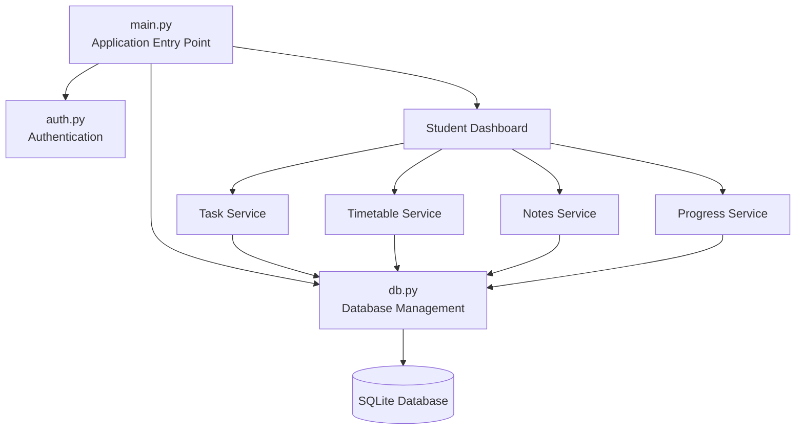
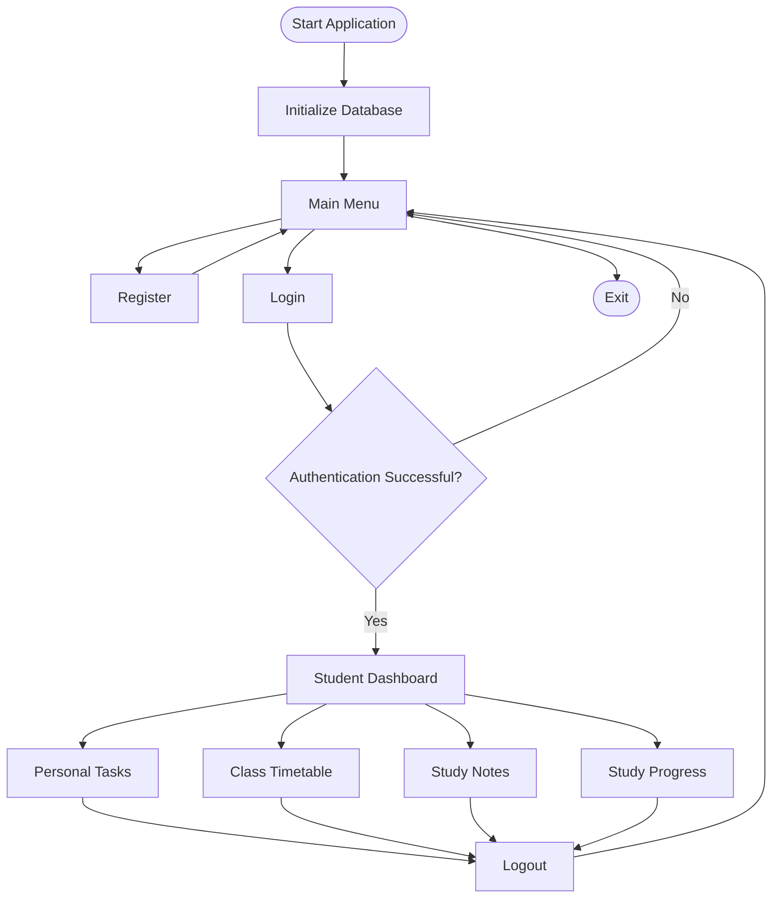

 <div align="center">

# 📚 StudyPlanner

### 🎓 Student Productivity & Academic Management Module

<p>
  
  
  
  
</p>

<p>
  
  
</p>

**Plan Your Studies. Manage Your Tasks. Track Your Progress.**

A modular Python-based academic productivity system developed as part of the larger **Student-Assistance** project.

</div>

---

## 📖 About

Welcome to **StudyPlanner**!

StudyPlanner is an academic management and productivity module of the larger [Student-Assistance](https://github.com/rimontanber96/Student-Assistance) project.

It is designed to help students organize their academic activities, manage personal study tasks, maintain class schedules, store study notes, and monitor their learning progress.

This module is developed using **Pure Python and SQLite**, focusing on modular programming, database management, authentication, and fundamental software development concepts.

> ⚠️ **Project Context:** StudyPlanner is an independent module within Student-Assistance. It is not the complete Student-Assistance application.

---

## 🎯 Project Objectives

- Organize personal academic tasks.
- Manage class timetables and schedules.
- Store and access study notes.
- Track study hours and learning progress.
- Provide basic student registration and login.
- Demonstrate modular Python application development.
- Maintain structured and persistent data using SQLite.

---

## 🌟 Features

| 🚀 Module | 📄 Description |
|---|---|
| 🔐 Authentication | Student registration and login functionality. |
| 📌 Personal Tasks | Create, view, and complete study tasks. |
| 📅 Class Timetable | Add and view class schedules. |
| 📝 Study Notes | Create, save, and view study notes. |
| 📊 Study Progress | Record study hours and covered topics. |
| 🗄️ Database | Store application data using SQLite. |

### 🔐 1. Authentication System

- Student registration.
- User login verification.
- Password hashing.
- User-specific data access.

### 📌 2. Personal Task Management

- Add personal study tasks.
- Set task priority (Low, Medium, High).
- Assign deadlines.
- View saved tasks.
- Mark tasks as completed.

### 📅 3. Class Timetable

- Add class schedules.
- Store subject names.
- Set class days and times.
- View saved timetable entries.

### 📝 4. Study Notes

- Create study notes.
- Store note titles and content.
- View previously saved notes.

### 📊 5. Study Progress

- Record study hours.
- Track covered topics.
- View saved progress records.
- Calculate total recorded study hours.

---

## ⚡ Technology Stack

<p>
  
</p>

| Technology | Purpose |
|---|---|
| Python | Core application development |
| SQLite | Local database management |
| SQL | Database operations |
| hashlib | Password hashing |
| os | File handling and random salt generation |
| Git | Version control |
| GitHub | Project hosting and collaboration |
| VS Codium | Development environment |

### 💡 Why Pure Python Instead of Django?

This version intentionally uses Pure Python without Django.

The primary goal is to understand the fundamentals of application development, including:

- Functions and classes.
- Modular programming.
- Database connectivity.
- SQL queries.
- Authentication logic.
- Application workflow.
- File and folder organization.

SQLite is selected because it is lightweight and does not require a separate database server.

---

## 🏗️ System Architecture

StudyPlanner follows a modular architecture where each component has a specific responsibility.



### Architecture Components

| Component | Responsibility |
|---|---|
| `main.py` | Controls application flow and navigation. |
| `auth.py` | Handles registration and login. |
| `db.py` | Manages database connections and tables. |
| `models/` | Defines Python data classes. |
| `services/` | Implements feature-specific operations. |
| `database/` | Stores the SQLite database file. |

---

## 📂 Repository Structure

```text
Student-Assistance/
│
├── StudyPlanner/
│   │
│   ├── main.py
│   ├── auth.py
│   ├── db.py
│   │
│   ├── models/
│   │   ├── __init__.py
│   │   ├── task.py
│   │   ├── timetable.py
│   │   ├── notes.py
│   │   └── progress.py
│   │
│   ├── services/
│   │   ├── __init__.py
│   │   ├── task_service.py
│   │   ├── timetable_service.py
│   │   ├── notes_service.py
│   │   └── progress_service.py
│   │
│   ├── database/
│   │   └── studyplanner.db
│   │
│   ├── assets/
│   │   └── screenshots/
│   │
│   └── README.md
│
└── README.md
```

---

## 🔄 Application Workflow



---

## 🖥️ Application Preview

The following screenshots demonstrate the current command-line interface.

### 1. Main Menu


### 2. Student Dashboard


### 3. Personal Task Management


### 4. Class Timetable


### 5. Study Progress


> 📌 Screenshots are placeholders until actual application screenshots are added to the repository.

---

## ⚙️ Getting Started

### Prerequisites

Before running the application, make sure you have:

- Python 3.x installed.
- VS Code or VS Codium.
- Git installed (optional).

**No external Python packages are required** for the current basic implementation because it uses Python standard-library modules, including `sqlite3`, `hashlib`, and `os`.

### 1. Clone the Main Repository

```bash
git clone https://github.com/rimontanber96/Student-Assistance.git
```

### 2. Navigate to StudyPlanner

```bash
cd Student-Assistance/StudyPlanner
```

### 3. Run the Application

```bash
python main.py
```

### 4. Register or Login

The application will display:

```text
===== STUDY PLANNER =====

1. Register
2. Login
3. Exit

Choose option:
```

Select `1` to create an account or `2` to log in.

### 5. Access the Dashboard

```text
===== STUDENT DASHBOARD =====

1. Personal Tasks
2. Class Timetable
3. Study Notes
4. Study Progress
5. Logout

Choose option:
```

Select the desired feature to manage your academic activities.

---

## 🗄️ Database Design

StudyPlanner uses SQLite for persistent data storage.

### Database Tables

| Table | Description |
|---|---|
| `users` | Stores student accounts and password hashes. |
| `tasks` | Stores personal study tasks. |
| `timetable` | Stores class schedules. |
| `notes` | Stores study notes. |
| `progress` | Stores study hours and topics. |

Each academic record includes a `user_id` field to associate records with their respective users.

---

## 🚧 Current Development Status

| Feature | Status |
|---|---|
| User Registration | ✅ Implemented |
| User Login | ✅ Implemented |
| Password Hashing | ✅ Implemented |
| Add/View Tasks | ✅ Implemented |
| Complete Tasks | ✅ Implemented |
| Add/View Timetable | ✅ Implemented |
| Add/View Notes | ✅ Implemented |
| Add/View Progress | ✅ Implemented |
| Edit/Delete Operations | 🔄 Planned |
| Advanced Input Validation | 🔄 Planned |
| Study Analytics | 🔄 Planned |
| GUI Interface | 🔄 Future Scope |

---

## 🚀 Future Improvements

- [ ] Complete CRUD operations for all modules.
- [ ] Improve input validation and error handling.
- [ ] Add date-wise study progress tracking.
- [ ] Introduce weekly and monthly study analytics.
- [ ] Add study reminders and notifications.
- [ ] Develop a graphical user interface.
- [ ] Improve database relationships and constraints.
- [ ] Add automated testing.
- [ ] Integrate with other Student-Assistance modules.

---

## 🤝 Contribution

StudyPlanner is developed as part of the broader Student-Assistance project.

The modular architecture makes it easier to maintain, test, and extend individual features.

For project-level contributions, visit the main repository:

👉 [Student-Assistance on GitHub](https://github.com/rimontanber96/Student-Assistance)

---

## 👨‍💻 Developer

<div align="center">

### YA

**Student-Assistance | StudyPlanner Module**

🔗 GitHub: [rimontanber96](https://github.com/rimontanber96)

</div>

---

## ⭐ Support

If you find this module interesting:

- ⭐ Star the main Student-Assistance repository.
- 🍴 Fork the repository.
- 📢 Share the project.
- 💡 Suggest improvements.

---

<div align="center">

### 📚 StudyPlanner

**Plan • Organize • Learn • Improve**

Part of the **Student-Assistance** Project.

Made with ❤️ using Python.

</div>

---

## 📜 License

Please refer to the main [Student-Assistance repository](https://github.com/rimontanber96/Student-Assistance) for licensing information.

